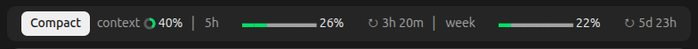

# usage-bar

A Claude Code mod that shows your context and usage limits as a one-line band above the prompt:



- **context**: how full the context window is, with the token count, measured like `/context` against the window where compaction happens.
- **5h** and **week**: how much of your 5-hour and weekly usage limits you've used, with a countdown to each reset. They refresh every 2 minutes from a background `claude -p /usage`, which uses no tokens, so they also count your other sessions and claude.ai.
- **Compact**: runs `/compact` in one click.

Each bar turns orange, then red with ⚠, as it nears its limit. When the context crosses the alert mark, a toast reminds you to compact. On a wide window the bars grow longer. On a narrow one the context bar becomes a small pie (a donut in the desktop app), then the 5h and week bars do too, then the resets go. Narrower still, the week section goes, then context shortens to ctx and finally loses its label, always keeping Compact and the context and 5h pies with their percentages on one row.

It works in the terminal and in the Claude desktop app.

## Install

In Claude Code, run:

```
/plugin marketplace add ramzigz/claude-usage-bar
/plugin install usage-bar@claude-usage-bar
```

Then run `/reload-plugins`, or start a new session.

If the install says "4 userConfig options not yet set", you can ignore it: the mod uses the defaults under [Settings](#settings) until you change them.

To update later, run this in a shell, then `/reload-plugins`:

```
claude plugin marketplace update claude-usage-bar && claude plugin update usage-bar@claude-usage-bar
```

## Settings

In Claude Code, run `/plugin configure usage-bar@claude-usage-bar`. From a shell, the same command without the slash shows the current values, and you can set any of them like this:

```
echo '{"contextWarnPercent": "60"}' | claude plugin configure usage-bar@claude-usage-bar --values-stdin
```

| Setting | Default | Effect |
| --- | --- | --- |
| Context warning (%) | 50 | The context bar turns orange. |
| Context alert (%) | 80 | The context bar turns red with ⚠, and a toast appears. |
| Usage limit warning (%) | 70 | The 5h and week bars turn orange. |
| Usage limit alert (%) | 90 | The 5h and week bars turn red with ⚠. |

## What it runs and sends

- **Program:** every 2 minutes, in interactive sessions only, the mod runs `claude -p /usage --no-session-persistence` with a one-minute timeout. It is the same Claude Code you are using, asking for the same numbers the `/usage` command shows: your 5-hour and weekly limits and when they reset. It uses no tokens, and `--no-session-persistence` keeps it out of your session list. This is the only program the mod runs.
- **Command:** the Compact button runs `/compact` in the current session, only when you click it.
- **Data:** the mod sends nothing anywhere itself. The `/usage` call goes to Anthropic, as `/usage` always does. The last limits it read are kept on your machine, in the plugin's own store, so a new session shows them right away.

## Development

```
claude plugin validate .
claude plugin test .
```

To try a local copy, start Claude Code with `claude --plugin-dir <path to this folder>`.

## License

MIT
